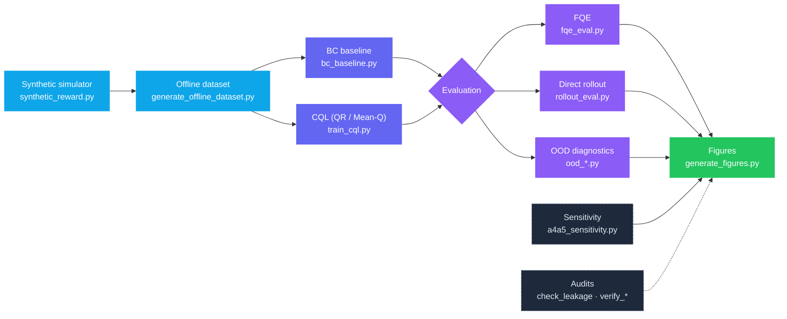

<div align="center">



<br/>

**Sumit Kumar Biswal** · **Dr. Bhramara Bar Biswal**

> **TL;DR:** We audited how offline RL policies (CQL vs BC) are evaluated on a groundwater pumping task. A policy's apparent advantage depends on the protocol: it changes with the estimator (FQE vs direct rollout), the baseline and critic pairing, and the state distribution, and CQL's advantage over BC reverses sign under genuine state-distribution shift.

<br/>


[](https://doi.org/10.5281/zenodo.22881193)

[Overview](#overview) ·
[Key findings](#key-findings) ·
[Pipeline](#pipeline) ·
[Layout](#repository-layout) ·
[Setup](#setup) ·
[Reproduce](#reproducing-the-results) ·
[Artifacts](#large-artifacts) ·
[Citation](#citation)

</div>

---

## Overview

This repository holds the code behind the manuscript above. It asks one narrow question about offline reinforcement learning (RL): **does the verdict on a policy change depending on how it is evaluated?**

The testbed is a synthetic **groundwater pumping** task. An agent chooses a discrete extraction level each quarter, and the simulator returns groundwater dynamics and a reward. Policies are trained offline from logged data (**BC** and **CQL**) and then judged under several evaluation protocols.

| | |
|---|---|
| **Task** | Synthetic groundwater pumping, discrete extraction level per quarter |
| **Policies** | Behavioural cloning (**BC**) and conservative Q-learning (**CQL**, with **QR** or **Mean-Q** critic) |
| **Protocols** | Off-policy estimate (**FQE**), direct simulator rollout, banded out-of-distribution (OOD) returns |
| **Trust checks** | Parameter sensitivity sweeps (A4/A5), leakage, provenance, and confidence-interval audits |

### What the audit varies

| Axis | What changes | Where to look |
|---|---|---|
| **Estimator** | Off-policy estimate (**FQE**) vs. direct simulator rollout | `src/rl/fqe_eval.py`, `src/rl/rollout_eval.py` |
| **Baseline / critic** | **BC** baseline; **QR** critic vs. **Mean-Q** critic in **CQL** | `src/rl/bc_baseline.py`, `src/rl/train_cql.py`, `ood_return_test*.py` |
| **Distribution** | Banded OOD returns and Mahalanobis state-distance partitioning | `ood_return_test*.py`, `ood_state_distribution_test.py` |

---

## Key findings

| Finding | Evidence in this repository |
|---|---|
| CQL's return advantage over BC **reverses sign** under genuine state-distribution shift, for both the QR and Mean-Q critics. The magnitude depends on the critic. | `ood_return_test.py`, `ood_return_test_meanq.py`, `ood_state_distribution_test.py` |
| A "scenario shift" with an OOD fraction of 0 is **not** out-of-distribution and must not be conflated with the state-distance diagnostic. | `ood_state_distribution_test.py` |
| The scenario-gap sign is robust to the two uncalibrated simulator constants (all 27 cells of the A4/A5 grid agree), but its **size varies by more than two orders of magnitude**. | `a4a5_sensitivity.py` |
| The simulator's rainfall–recharge assumption has the right **sign** against held-out CGWB wells; amplitude is not calibrated. | `cgwb_behavioral_validation.py` |
| All 114 archived checkpoints match their stated configuration (zero mismatches). This confirms provenance, not that the hyperparameters are optimal. | `verify_provenance.py` |

---

## Pipeline



---

## Repository layout

```text
trishna-opal/
├── src/
│   ├── rl/                 # RL environment, dataset, training, evaluation  <- this paper
│   ├── downscaling/        # companion paper (context only)
│   ├── models/             # companion paper (context only)
│   └── data/               # companion paper (context only)
├── config/                 # source-of-record hyperparameters (YAML)
├── data/                   # archived RF seed table and held-out wells
├── scripts/                # visualization helpers (companion paper)
├── tests/                  # unit tests for grid alignment, splits, reward
├── ood_return_test.py
├── ood_return_test_meanq.py
├── ood_state_distribution_test.py
├── a4a5_sensitivity.py
├── cgwb_behavioral_validation.py
├── check_leakage.py
├── verify_provenance.py
├── verify_ci.py
├── freeze_project.py
├── generate_figures.py
├── environment.yml
└── requirements.txt
```

> [!NOTE]
> This repository is the full **`trishna-opal`** project, which produced **two papers**. The offline-RL audit uses only the files listed in this README. `src/downscaling/`, `src/models/`, and `src/data/` belong to the companion downscaling paper and are included for context. **The RL experiments do not require running them**, because the RF seed table and held-out wells are already archived under `data/`.

<details>
<summary><b>Component reference</b></summary>

<br/>

**RL environment and training**

| File | Purpose |
|---|---|
| `src/rl/synthetic_reward.py` | Synthetic groundwater pumping simulator |
| `src/rl/generate_offline_dataset.py` | Offline dataset generator |
| `src/rl/bc_baseline.py` | Behavioural cloning (**BC**) training |
| `src/rl/train_cql.py` | Conservative Q-learning (**CQL**) training |

**Evaluation**

| File | Purpose |
|---|---|
| `src/rl/fqe_eval.py` | Fitted Q-evaluation (**FQE**) |
| `src/rl/rollout_eval.py` | Direct simulator rollout |
| `ood_return_test.py` | Banded OOD diagnostic, **QR** critic |
| `ood_return_test_meanq.py` | Banded OOD diagnostic, **Mean-Q** critic |
| `ood_state_distribution_test.py` | Mahalanobis state-distance partitioning |

**Sensitivity and validation**

| File | Purpose |
|---|---|
| `a4a5_sensitivity.py` | A4/A5 parameter sweep |
| `cgwb_behavioral_validation.py` | Rainfall–groundwater sign check on held-out wells |

**Audits and reproducibility**

| File | Purpose |
|---|---|
| `check_leakage.py` | Leakage check |
| `verify_provenance.py` | Checkpoint provenance check |
| `verify_ci.py` | Confidence-interval verification |
| `freeze_project.py` | Project freeze for the submitted state |

**Figures**

| File | Purpose |
|---|---|
| `generate_figures.py` | Generates the manuscript figures |

</details>

---

## Setup

```bash
# 1. Create and activate the environment
conda env create -f environment.yml
conda activate trishna-opal

# 2. Install the remaining Python dependencies
pip install -r requirements.txt
```

For a description of the datasets and how the initial states were sourced, see [`DATA.md`](DATA.md).

### Fast path: view figures only

To see the generated plots without re-training any models, download the per-episode return arrays from the datasets Zenodo record (see [Large artifacts](#large-artifacts)), then run:

```bash
conda env create -f environment.yml
conda activate trishna-opal
pip install -r requirements.txt
python generate_figures.py
```

---

## Reproducing the results

Run the stages in this order. Each stage reads the outputs of the one before it.

```bash
# 1. Build the offline dataset from the simulator
python src/rl/generate_offline_dataset.py

# 2. Train the policies
python src/rl/bc_baseline.py
python src/rl/train_cql.py

# 3. Evaluate
python src/rl/fqe_eval.py
python src/rl/rollout_eval.py
python ood_return_test.py
python ood_return_test_meanq.py
python ood_state_distribution_test.py

# 4. Sensitivity and validation
python a4a5_sensitivity.py
python cgwb_behavioral_validation.py

# 5. Audits
python check_leakage.py
python verify_provenance.py
python verify_ci.py

# 6. Figures
python generate_figures.py
```

> [!TIP]
> Training and evaluation scripts may take command-line options (for example, the critic type in `train_cql.py`). Run any script with `--help` to see them.

The `.h5` datasets, `.d3` checkpoints, and per-episode return arrays are **not** in this repository. Download them first (see below), or regenerate them with steps 1–2.

> [!WARNING]
> Regenerating from steps 1–2 trains new BC and CQL models. Results can differ from the archived checkpoints, and BC-versus-CQL contrasts are sensitive to which BC checkpoint is paired with which CQL checkpoint. For the reported numbers, evaluate the archived checkpoints.

---

## Large artifacts

Large files are archived separately on **Zenodo** to keep the repository small:

- `.h5` offline datasets
- `.d3` model checkpoints
- per-episode return arrays

| Record | Contents | DOI |
|---|---|---|
| **Code and audit artifacts** | This repository's code and audit outputs | [10.5281/zenodo.22881193](https://doi.org/10.5281/zenodo.22881193) |
| **Datasets and model checkpoints** | `.h5`, `.d3`, per-episode returns | *second Zenodo record, DOI to be added* |

---

## Citation

If you use this code, please cite the manuscript:

```bibtex
@unpublished{biswal_protocol_dependent_verdicts,
  title  = {Protocol-Dependent Verdicts in Offline Reinforcement Learning:
            An Audit of Estimator, Baseline, and Distribution Sensitivity
            on a Groundwater Pumping Task},
  author = {Biswal, Sumit Kumar and Biswal, Bhramara Bar},
  note   = {Manuscript}
}
```

---

## License

See [`LICENSE`](LICENSE).

## Contact

Questions about the code or the manuscript: open an issue on this repository.
